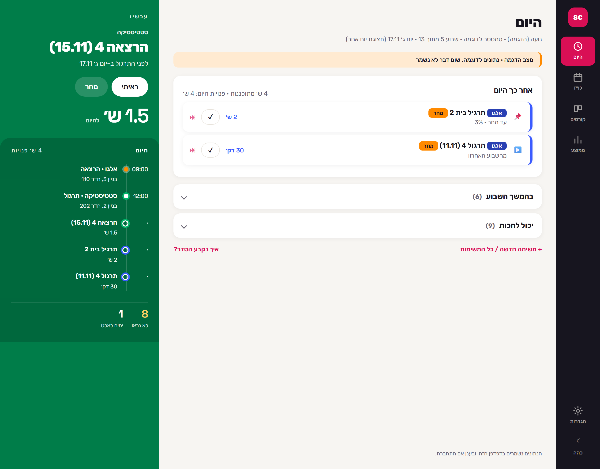
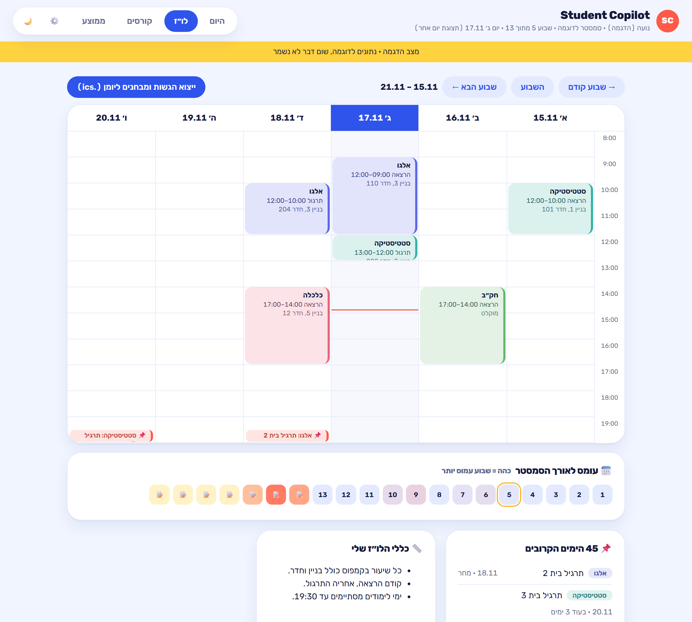
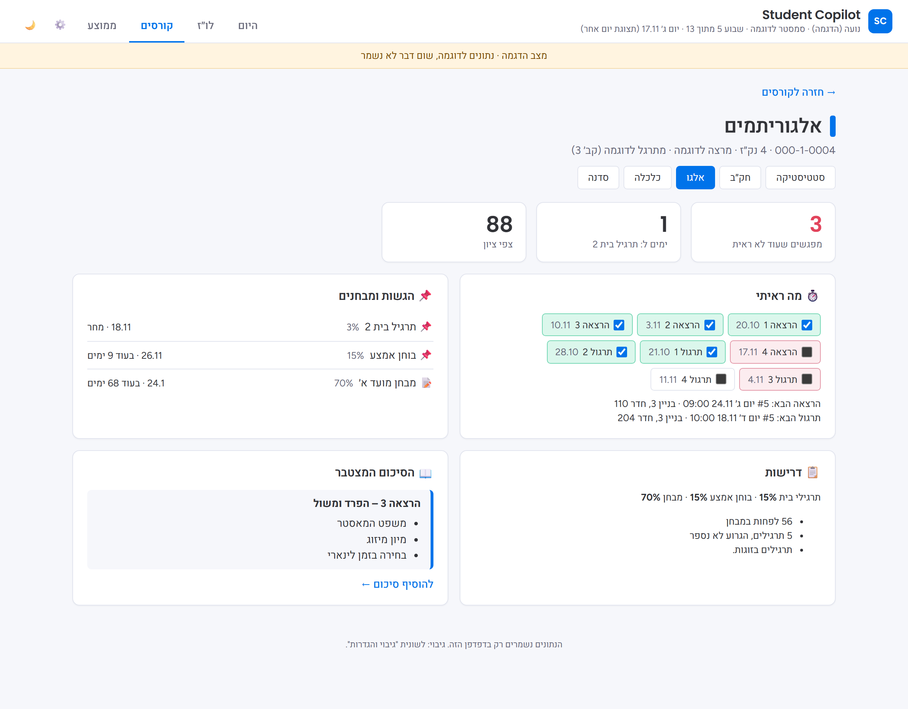
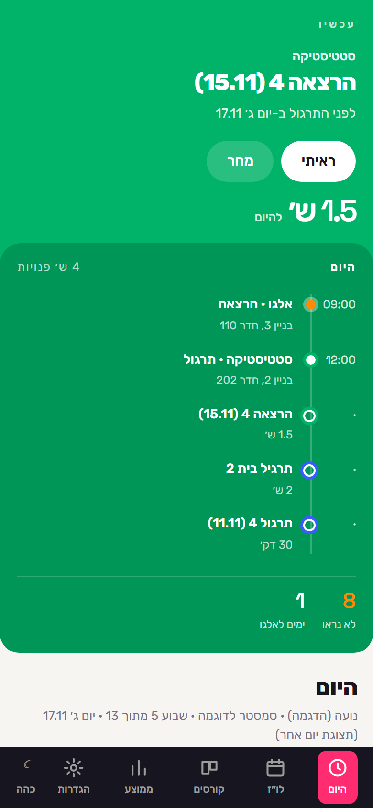
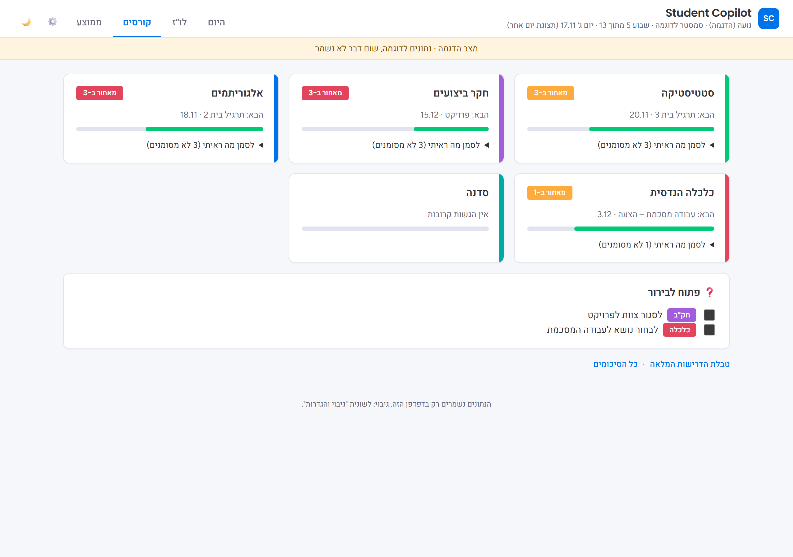
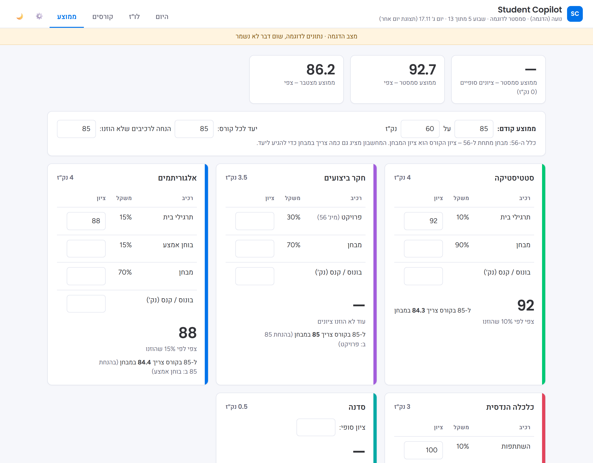
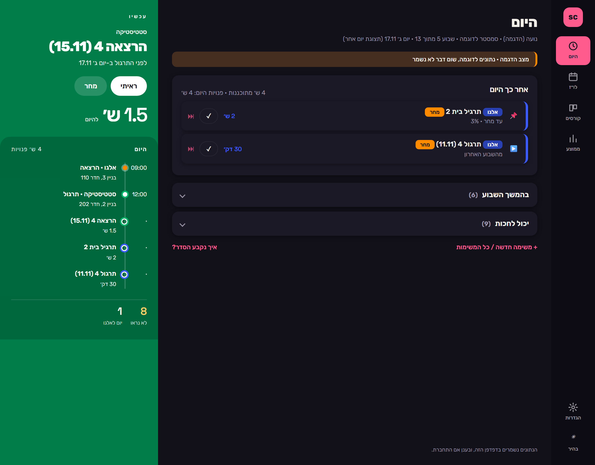
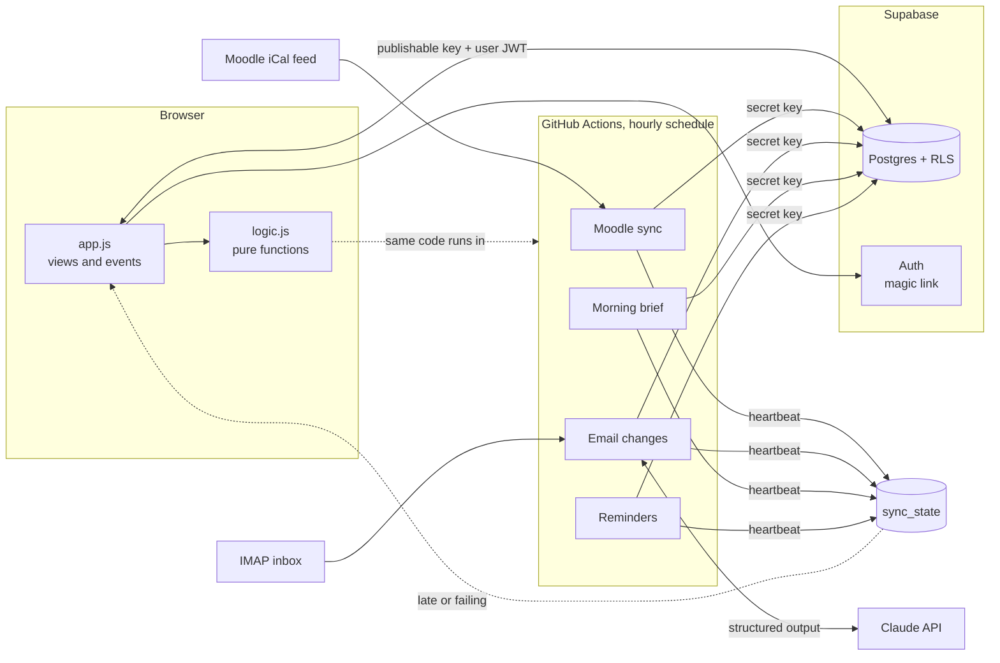

# Student Copilot

[](https://github.com/aradyaacovi/student-copilot/actions/workflows/test.yml)
[](https://aradyaacovi.github.io/student-copilot/?demo=1)
[](LICENSE)


**A semester command center that answers one question: _what should I work on right now?_**

Live demo: **[aradyaacovi.github.io/student-copilot](https://aradyaacovi.github.io/student-copilot/?demo=1)** — the real app on bundled demo data, nothing saved.

Student Copilot pulls a student's whole semester into one place: course requirements, deadlines, the weekly schedule, lecture progress, grades and cumulative summaries. It turns all of that into a single prioritized daily plan. Background automations keep it current by syncing Moodle and reading schedule-change emails.

Built for Hebrew (RTL) first. No framework, no build step.

| | |
|---|---|
| **Problem** | A semester's obligations are scattered across syllabi, Moodle, email and the calendar, and long task lists do not say what to do next. |
| **Approach** | One prioritization function ranks every task by effort and slack, so the app shows one "now" task and a plan sized to today's free hours. |
| **Stack** | Vanilla JavaScript, Supabase (Postgres, row-level security), n8n, Claude API for email interpretation, GitHub Actions |
| **My part** | Designed and directed the product and its rules, used it daily across a seven-course semester; Claude Code implemented. See [How it was built](#how-it-was-built). |
| **Proof** | 78 tests in CI, a live demo, and a documented security model. The demo interface is in Hebrew (right to left). |



| Schedule and semester load | Course page | Mobile |
| --- | --- | --- |
|  |  |  |

<details>
<summary>More screenshots</summary>





</details>

All screenshots use the bundled demo data and a pinned clock (`?demo=1&today=…&now=…`), so they are reproducible: `node tools/shots.js`.

**The layout is the argument.** Three zones, not a page of cards: a dark rail for navigation, a bright working area, and a focus panel — painted in the colour of whatever you should be doing right now — that stays on screen on every tab, carrying the one task, today's ribbon of classes and work, and the day's numbers. Every course owns a vivid hue and keeps it everywhere: chips, rows, calendar blocks, progress. Four themes ship with it plus a dark mode.

## Install it

The app is a PWA. On Chrome or Edge, open it and choose **Install** from the address bar or the ⋮ menu; on iOS, Safari → Share → Add to Home Screen. Once installed it opens without browser chrome and keeps working offline — the service worker caches the shell and the semester data, while Supabase requests always go to the network so a stale deadline is never shown.

## The problem

A semester's obligations are scattered: syllabi, Moodle, the calendar, lecturer emails, and a mental list of lectures not yet watched. Most student dashboards answer "what do I have to do?" with a long list. The first version of this project did the same, with eight tabs, and it was overwhelming to use. The redesign started from a different question: given limited hours today, what is the one thing to do now, and why?

## What it does

- **Focus plan.** One "now" card, a short plan sized to today's free hours, and everything else collapsed.
- **Pace tracker.** Counts the lectures and tutorials that actually took place (minus cancellations, plus make-ups) and tracks which ones were watched.
- **Schedule.** Weekly grid with overlapping sessions side by side, deadlines, a semester workload heatmap and `.ics` export.
- **Grades.** Weighted course grades with pass rules, credit-weighted semester and cumulative averages, and the exam grade needed to hit a target.
- **Course pages.** Requirements, deadlines, progress, grade and a cumulative summary per course.
- **Automations.** Moodle sync, email-driven schedule changes, a morning brief and deadline reminders.
- **Installable.** A progressive web app: installs to the home screen, runs full-screen, and works offline from a cached app shell.

## How prioritization works

Every kind of work (submissions, exams, catching up on lectures, spaced reviews, custom tasks) goes through one function, [`buildPlan`](js/logic.js):

1. **Estimate effort** in hours from the item's type and its weight in the grade (a 20% project is about 10 hours; a missed lecture is 1.5).
2. **Derive a start-by date**: the due date minus the days that effort needs at the student's daily capacity.
3. **Rank by slack**, the days left until the start-by date. Ties go to the item worth more of the grade.
4. **Fill today's plan** up to the free hours left today (after in-person classes, until the day's end time), capped at two hours per item so large projects spread across days. Only a real deadline due today or tomorrow may exceed capacity, and the UI flags the overload.
5. **Spread backlog**: old unwatched lectures are queued two per day, oldest first, lecture before tutorial, so a large backlog becomes a steady plan instead of a wall of red.

Each item carries a one-line reason ("10 days left, ~10 hours of work, start today"), so the ordering is explainable rather than a black box.

## Architecture



More diagrams (data model, automation run, email decision flow, planner, CI/CD): [docs/DIAGRAMS.md](docs/DIAGRAMS.md). The design decisions and their trade-offs are in [docs/ARCHITECTURE.md](docs/ARCHITECTURE.md). The short version:

- **One logic module, two runtimes.** `js/logic.js` is pure (no DOM, no I/O). The browser loads it directly, and a small build script bundles the same file into the n8n Code nodes, so the morning brief and the app can never disagree about priorities.
- **Workflows are generated, not hand-edited.** `automations/build.js` produces the n8n JSON from tested source in `automations/lib/`. The test suite executes the generated workflow code against a fake Supabase, Moodle and Claude.
- **The model extracts, code decides.** For schedule-change emails, Claude returns schema-constrained JSON describing what the email says. Deterministic code then resolves which class instance is meant, checks it against the real timetable, and either applies the change or queues it for the student's approval.
- **Works with no backend.** Without Supabase configured, the app runs entirely from a local data file and `localStorage`.

## Automations

| Workflow | Trigger | What it does |
| --- | --- | --- |
| Moodle sync | every 3 hours | Reads the Moodle iCal feed, matches each event to a course by its course number, upserts deadlines and alerts on new ones |
| Email changes *(off)* | new email (IMAP) | Extracts cancellations, make-ups, moves and new deadlines; applies confident ones, queues uncertain ones for approval |
| Morning brief | daily 07:23, weekly on Sunday | Today's classes, top priorities, pace per course, what changed |
| Calendar sync *(off until configured)* | hourly, 07:00-22:00 | Reads busy hours only (never titles) from Google Calendar, read-only; the plan then subtracts them from free time. Setup: [docs/CALENDAR_SETUP.he.md](docs/CALENDAR_SETUP.he.md) |
| Reminders | daily 18:00 | Due tomorrow, large submission in 3 days, time to start exam prep, unwatched lecture before tomorrow's tutorial |

The email workflow ships disabled: Gmail over IMAP needs an app password, which Google only offers on accounts with 2-Step Verification turned on. Everything else runs.

Safety rules for the email workflow: email content is treated as data, never as instructions; a change for a different tutorial group is ignored; an ambiguous course, an unknown group or a date that does not fall on a real class goes to manual review; the workflow never sends email.

## Security and privacy

- Personal data (`data/my-semester.js`), the Supabase config and automation secrets are git-ignored. The repository ships demo data only.
- Every table has row-level security keyed to `auth.uid()`, so the schema is already multi-tenant.
- The browser holds only the publishable key. The secret key lives in the automation environment.
- Secrets are read from environment variables at run time and are never written into workflow files.

## Tests

```bash
npm test
```

78 tests (28 logic, 38 automations, 12 UI smoke), zero dependencies, run in CI on every push. They cover session counting against a known timetable, grade rules, the planner, iCal parsing in the real Moodle format, email interpretation rules, and end-to-end execution of all four generated workflows in a simulated n8n runtime.

The UI smoke tests (`npm run test:ui`, about 10 seconds) open the demo in a headless Chrome or Edge over the DevTools protocol, with the date and time pinned (`?today=` and `?now=`). They check: no console errors, one task plus today's plan, tab switching, that "done" and "seen" are saved in localStorage and never reach the cloud, that an empty semester does not break the page, that grades and settings are saved, and that nothing scrolls sideways at 375px. A failed test saves a screenshot to `test-results/` (CI uploads it as an artifact). Personal data, cloud settings and the network are mocked, so the result is the same on every machine. Set `CHROME_PATH` if no browser is found; locally the test skips without one, in CI it fails.

## Run it

```bash
npm start
```


Then open `http://localhost:5180/?demo=1` for the demo. To use your own semester, copy `data/sample-semester.js` to `data/my-semester.js` and rename `SAMPLE_DATA` to `SEMESTER_DATA`. Cloud sync and automations are optional: see [automations/README.md](automations/README.md) (Hebrew).

A Hebrew user guide is in [docs/USER_GUIDE.he.md](docs/USER_GUIDE.he.md).

## Project structure

```
index.html              single page
css/style.css           theme (RTL, light and dark)
js/logic.js             pure logic: pace, grades, planner, calendar, merge
js/app.js               views and event handling
data/sample-semester.js demo data
automations/lib/        Moodle, email, briefs, Supabase helper
automations/build.js    generates automations/workflows/*.json
automations/run-local.js run one automation without n8n
supabase/schema.sql     tables and RLS policies
tests/                  logic, automation and UI smoke tests
tools/serve.js          dependency-free static server
tools/shots.js          reproducible documentation screenshots (DevTools protocol)
tools/icons.js          generates the app icons from one SVG
sw.js                   service worker: offline app shell
manifest.webmanifest    PWA manifest
icons/                  generated app icons
docs/                   architecture, user guide, screenshots
```

## Tech

Vanilla JavaScript, HTML and CSS · Supabase (Postgres, Auth, RLS) · n8n · Claude API (structured outputs) · Node.js test runner scripts · GitHub Actions

## Roadmap

- Multi-student onboarding: Google sign-in, a shared course catalog keyed by course number, syllabus upload with automatic extraction of grade components.
- Calendar: read busy time into the daily plan first, then write catch-up blocks into free slots. Design and the Google scope constraints: [docs/CALENDAR_WRITE_BACK.md](docs/CALENDAR_WRITE_BACK.md).
- Per-exam topic checklists built from the cumulative summaries.

## How it was built

Designed and directed by me, with Claude Code as a pair programmer for implementation. Product decisions (the one-question focus, the prioritization rules, the approval step for uncertain email changes) came from using it daily during a seven-course semester.

## License

MIT
