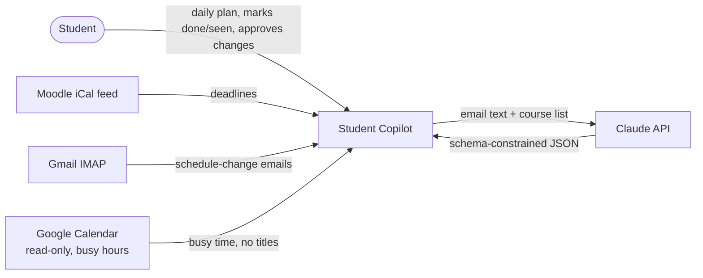
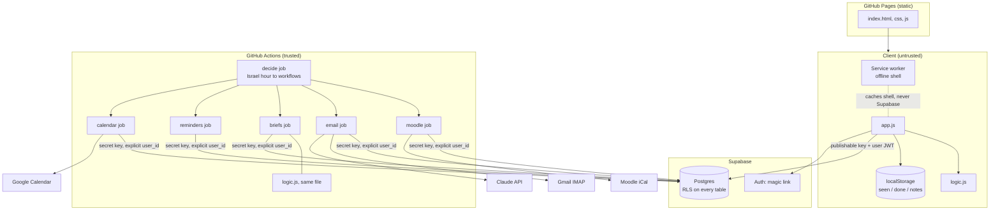
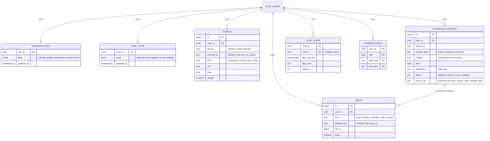
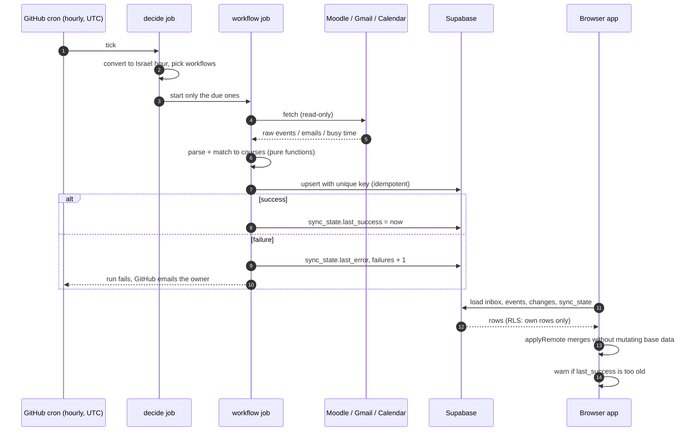
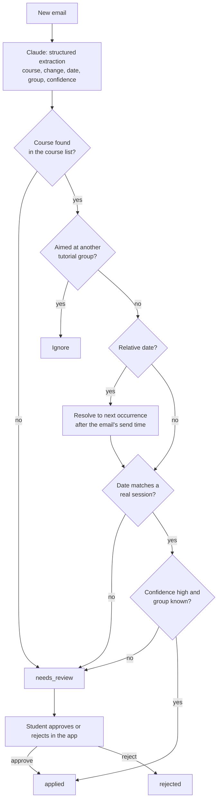
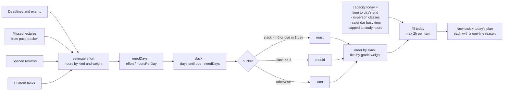
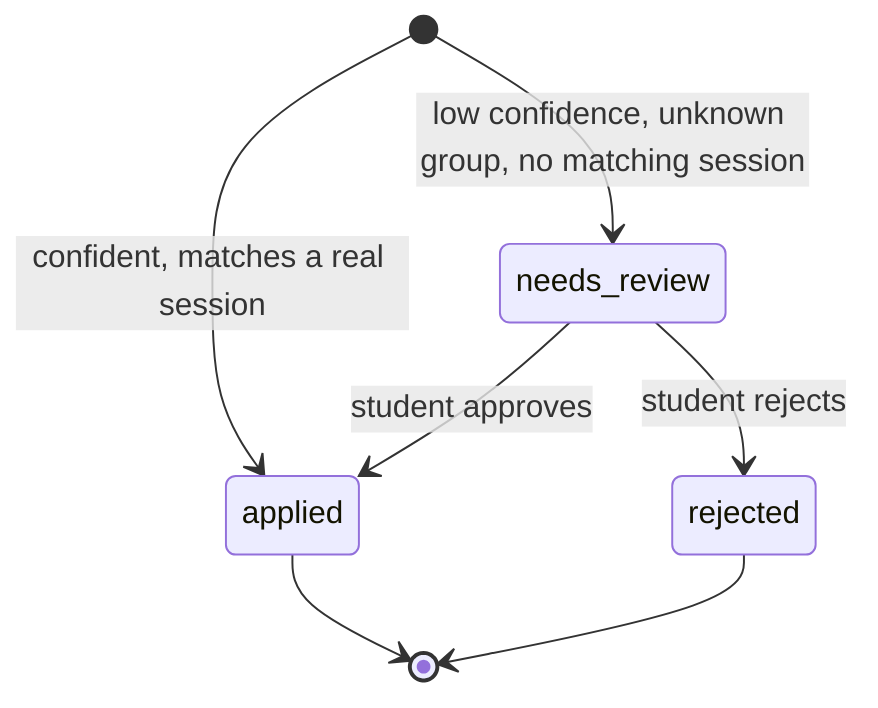
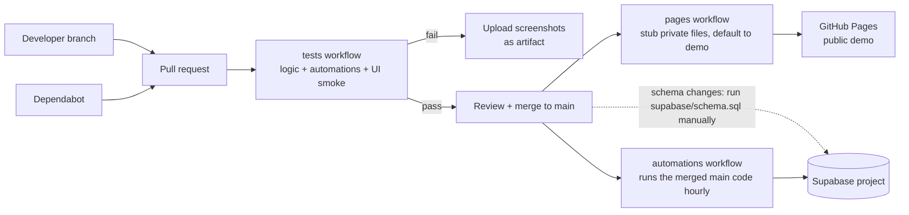
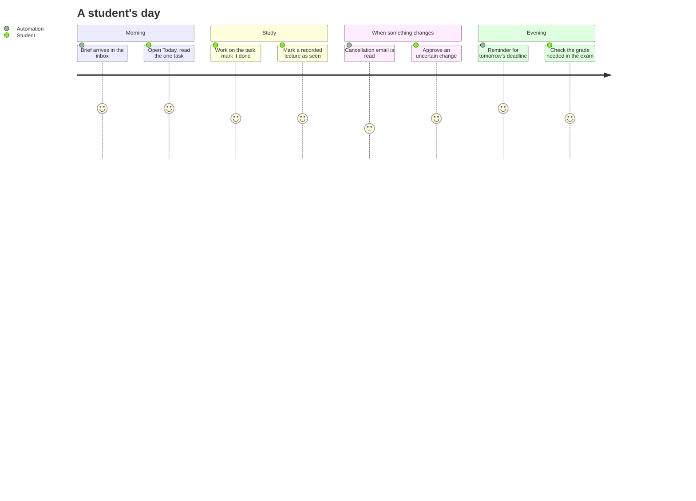

# Diagrams

All diagrams are [Mermaid](https://mermaid.js.org/), so GitHub renders them and they live in version control next to the code. Each one answers a different question; the written reasoning is in [ARCHITECTURE.md](ARCHITECTURE.md).

| # | Diagram | Question it answers |
| --- | --- | --- |
| 1 | System context | Who and what does the system talk to? |
| 2 | Containers | What runs where, and with which credentials? |
| 3 | Data model (ERD) | What is stored, and how are duplicates prevented? |
| 4 | Automation run (sequence) | What happens on each scheduled run, and how is silence detected? |
| 5 | Email change decision | How does the app decide whether to apply a schedule change? |
| 6 | Planner pipeline | How is "what now" computed? |
| 7 | Schedule change lifecycle | Which states can a change be in? |
| 8 | CI/CD and environments | How does code reach production? |
| 9 | User journeys | What does the student do, and what happens automatically? |

## 1. System context

## 2. Containers and trust boundaries

The browser only ever holds the publishable key and the user's own session. The secret key exists only in GitHub Actions secrets, one job per automation, each job receiving only what it needs.

## 3. Data model

`semester_data` and `user_state` are one JSON document per user. The other tables are written by automations and made idempotent by unique keys, so a workflow that runs twice never duplicates a row.

## 4. One automation run

Every run reports a heartbeat, so the app can tell the difference between "nothing changed" and "the sync has stopped" ([ADR 0003](decisions/0003-heartbeat-for-silent-failures.md)).

## 5. Email change decision

The model extracts. Fixed code decides.

## 6. Planner pipeline

Single source of ordering: `L.buildPlan` ([logic.js](../js/logic.js)).

## 7. Schedule change lifecycle

## 8. CI/CD and environments

| Environment | What it is | Data |
| --- | --- | --- |
| Local | `npm start`, `?demo=1` or `data/my-semester.js` | Demo or personal file, never committed |
| CI | GitHub Actions, headless browser, fake Supabase and Claude | Fixtures only |
| Production (demo) | GitHub Pages | Bundled demo data |
| Production (personal) | Same static files, Supabase configured through the git-ignored `js/config.js` | The student's own rows, protected by RLS |

## 9. User journeys

